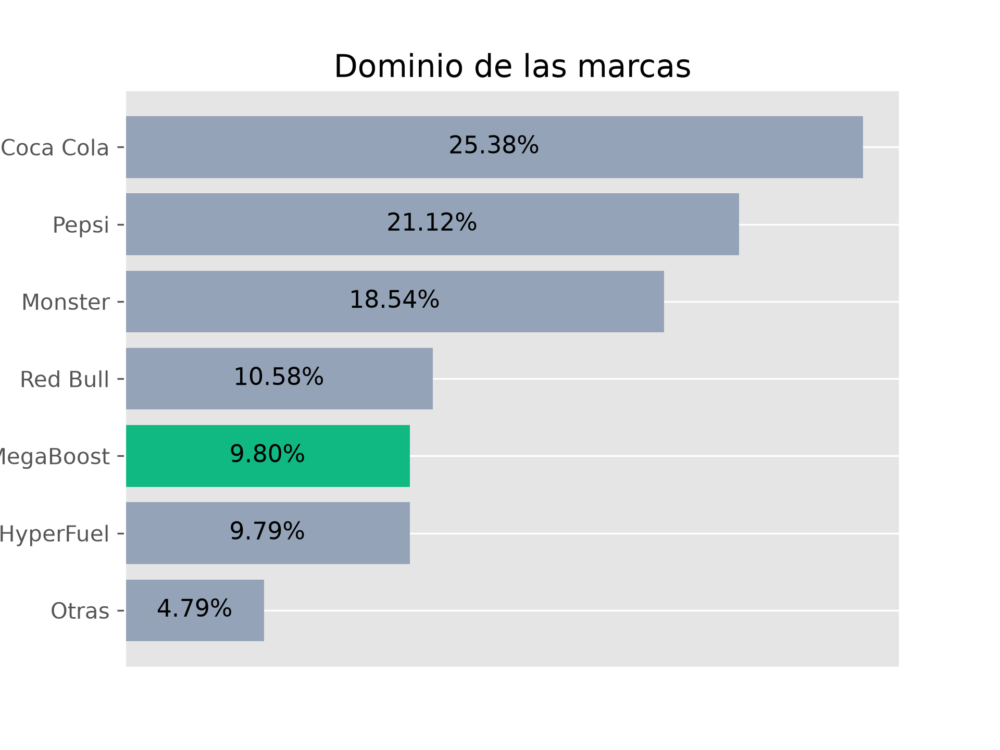
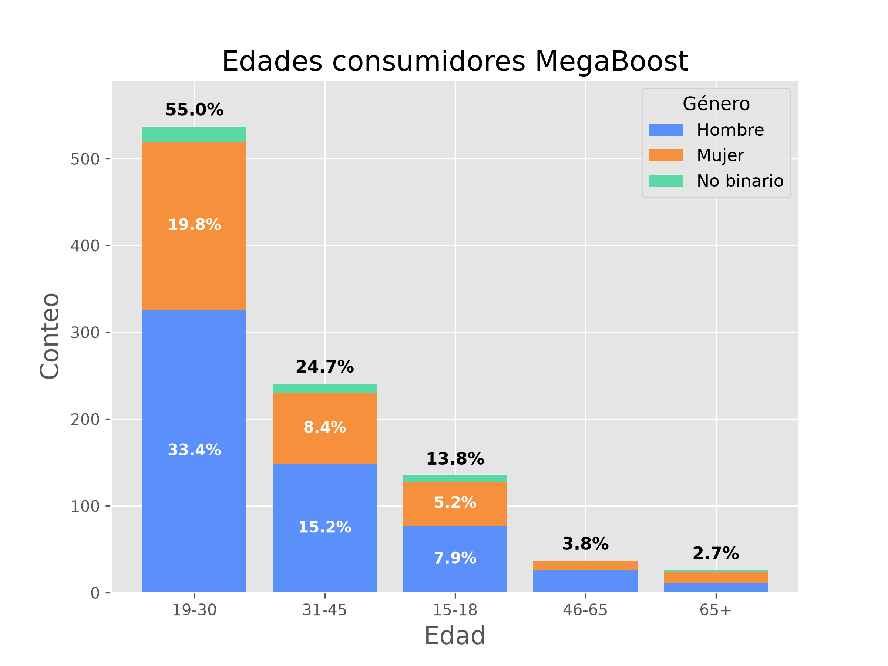
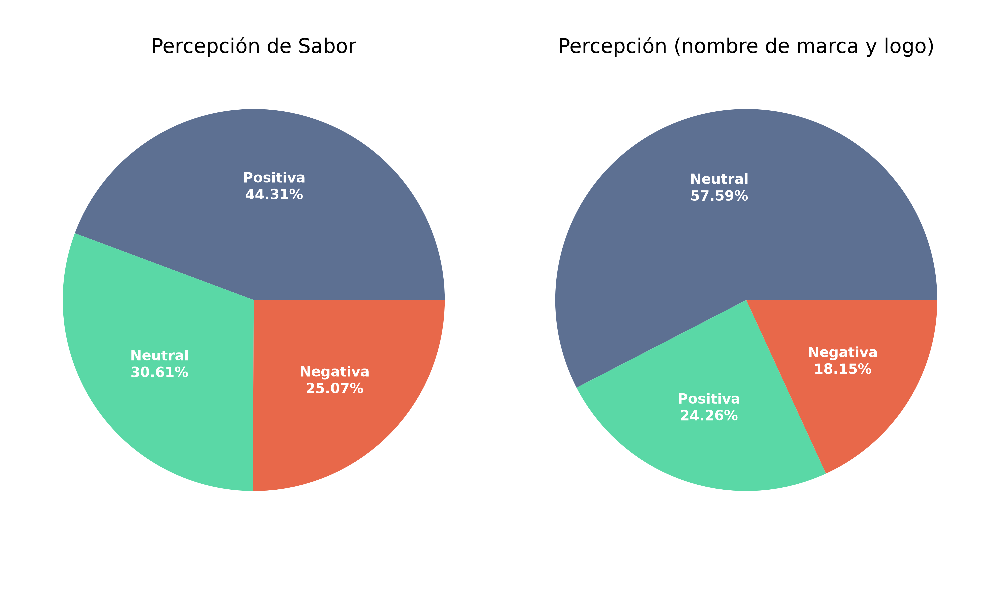
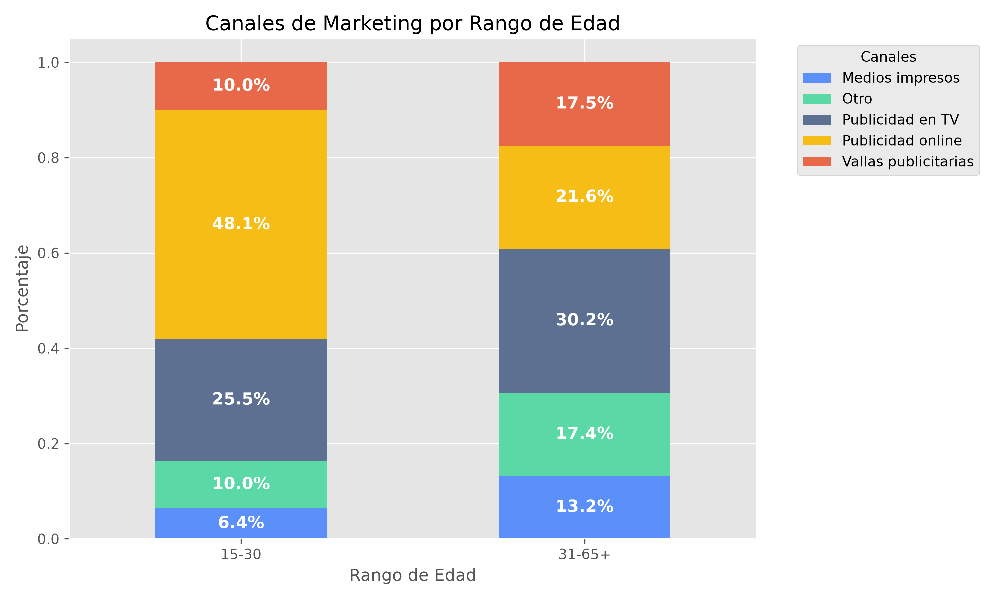

# Análisis de datos aplicado a una nueva bebida energizante (MegaBoost)

> **Resumen:** MegaBoost, una marca inglesa de bebidas energizantes, lanzó su producto en 10 ciudades de Italia. A partir de una encuesta a 10.000 personas se analizó quién la consume, contra quién compite y cómo mejorar su posicionamiento. Resultado: MegaBoost es **5ª con 9,8% de cuota de mercado**, en **8 de las 10 ciudades** al menos la mitad de los encuestados no la conoce, y las mayores oportunidades están en el sabor, la distribución y la publicidad por segmento.

📓 [Ver el análisis completo en el notebook](Energizantes.ipynb)

## Planteamiento del Problema

MegaBoost es una marca de bebidas energizantes de Inglaterra y desea ingresar al mercado italiano. Hace algunos meses lanzaron su bebida en 10 ciudades de Italia.

El equipo de marketing está a cargo de incrementar el posicionamiento de la marca y la participación en el mercado, además de apoyar el desarrollo del producto. Para esto aplicaron una encuesta a 10.000 personas en esas 10 ciudades.

## Set de Datos

- [Formato de encuesta realizada a 10.000 personas](metadata/encuesta_bebida_energizante.pdf)
- [Dataset principal (.csv) con 10.000 respuestas de la encuesta](data/dataset_bebida_energizante.csv)
- [Metadatos con la descripción de la información contenida en el set de datos](metadata/metadatos_dataset_bebida_energizante.txt)

Tras la limpieza quedaron **9.988 respuestas** (se descartaron 12 filas con datos faltantes).

## Metodología

- **Limpieza:** normalización de los nombres de columnas (sin tildes, en `snake_case`), eliminación de columnas sin valor analítico (identificadores) y descarte de las filas con datos faltantes, con `NumPy` y `Pandas`.
- **Análisis exploratorio (EDA):** respuestas organizadas por bloques de preguntas: perfil demográfico, competencia, canales de marketing, penetración de la marca, preferencias del consumidor, comportamiento de compra y desarrollo de producto.
- **Visualización:** gráficos analíticos con `Matplotlib`.

## Insights

- **Perfil demográfico:** MegaBoost es elegida por cerca del 10% de los encuestados (976 consumidores con edad registrada). Entre ellos, el **60% son hombres, el 36% mujeres y el 4% personas no binarias**. El grupo de edad con más consumidores es el de 19 a 30 años (55%), seguido por el de 31 a 45 (24,7%) y el de 15 a 18 (13,8%). Las ciudades que más la eligen son Turín (30%), Venecia (18%) y Roma (16%).

- **Competencia y posicionamiento:** los líderes del mercado son Coca-Cola (25,38%), Pepsi (21,12%) y Monster (18,54%), que acumulan cerca del 65% de participación. MegaBoost ocupa el 5º lugar con un 9,80% (ver gráfico al inicio).

- **Percepción de marca:**
  - Entre quienes conocen la marca, el 58% percibe el nombre y el logo como neutral (24% positivo, 18% negativo), y el 56% de quienes la probaron puntúa el sabor entre 1 y 3 sobre 5.
  - En 8 de las 10 ciudades (Palermo, Florencia, Venecia, Pisa, Turín, Génova, Verona y Siena) al menos el 50% de los encuestados no conocía la marca.
  - Quienes prefieren otras marcas lo hacen por su reputación (27%), su sabor (20%) y porque son más fáciles de encontrar (19%).

- **Canales de marketing efectivos:** la publicidad online y la televisión son los medios más efectivos. La online predomina en el rango de 15 a 30 años (48,1%), mientras que la TV cobra mayor relevancia en el grupo de 31 a 65+ años (30,2%).

- **Preferencias del consumidor:**
  - **Ingredientes:** los más esperados son la cafeína (39%) y las vitaminas (25%). El 50% estaría dispuesto a consumir una bebida con ingredientes naturales u orgánicos.
  - **Empaque:** predominan las latas compactas y portables (40%), seguidas por las botellas de diseño innovador (30%). El 60% no está interesado en ediciones limitadas.
  - **Ocasiones de consumo:** hacer deporte (45%) y estudiar o trabajar hasta tarde (32%).
  - **Puntos de venta:** supermercados (45%), tiendas online (25%) y gimnasios (15%).
  - **Factores de decisión:** reputación de la marca, sabor y disponibilidad en góndola.
  - **Mejoras sugeridas:** reducir el azúcar (30%) y agregar más ingredientes naturales (25%).

## Recomendaciones

1. Mantener la publicidad dirigida a hombres de 19 a 30 años, en modalidad online, y reforzar la televisión para los rangos de 31 a 65 años o más.
2. Reforzar la publicidad en dos frentes: (1) mujeres y personas no binarias, hoy el 36% y el 4% de los consumidores frente al 60% de hombres, y (2) las ocho ciudades con menor conocimiento de la marca: Palermo, Florencia, Venecia, Pisa, Turín, Génova, Verona y Siena.
3. Ajustar la fórmula para acercar el sabor a las preferencias de los consumidores: reducir el azúcar y sumar ingredientes naturales, manteniendo la cafeína y las vitaminas como ingredientes centrales (son los más esperados).
4. Fortalecer la cadena de distribución para que la bebida esté disponible en las ciudades de interés, con prioridad en los supermercados.
5. Mantener la comercialización en latas compactas y portables, orientando las campañas a los dos escenarios de consumo más frecuentes: hacer deporte y tener energía para rendir en el trabajo o el estudio.

## 📁 Estructura del Repositorio

| Carpeta / archivo | Contenido |
|---|---|
| [`Energizantes.ipynb`](Energizantes.ipynb) | Notebook con el análisis completo, paso a paso. |
| [`data/`](data) | Dataset de la encuesta (`.csv`). |
| [`metadata/`](metadata) | Formato de la encuesta (PDF) y descripción de las columnas. |
| [`plots/`](plots) | Gráficos generados con Matplotlib. |

## ▶️ Cómo Reproducirlo

1. Clonar el repositorio (el dataset ya está incluido en `data/`).
2. Instalar las dependencias: `pip install pandas numpy matplotlib jupyter`.
3. Abrir y ejecutar `Energizantes.ipynb`.
